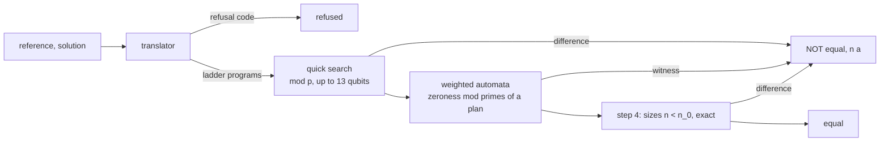

# ladder_ec

[](https://doi.org/10.5281/zenodo.24059427)

`ladder_ec` decides whether two Qiskit generators `solve(n)` or `solve(n, a)` build equivalent circuits for every
size `n` and every bit string `a`. Code and data of the paper
"Parameterized equivalence checking of quantum circuit generators via weighted automata"
(P. Chuklanov, [arXiv:2611.12049](https://doi.org/10.48550/arXiv.2611.12049)).

## Quick start

```
pip install -e .            # Python 3.13, Qiskit 2.5.2, NumPy 2.5.3
```

`tests/generators/ghz.py` holds three GHZ generators: `ghz_ref` (CNOT chain), `ghz_star` (all CNOTs from qubit 0),
`ghz_phase` (the chain, then Z on the last qubit).

```
$ python -m ladder_ec tests/generators/ghz.py:ghz_ref tests/generators/ghz.py:ghz_star --relation eq0
equal, exact

$ python -m ladder_ec tests/generators/ghz.py:ghz_ref tests/generators/ghz.py:ghz_star --relation eq
NOT equal
counterexample at n = 3 (found by quick_search)
```

```python
from ladder_ec import check
r = check("tests/generators/ghz.py:ghz_ref", "tests/generators/ghz.py:ghz_star", relation="eq0")
r["answer"]          # 'equal, exact'
r["counterexample"]  # None, or {"n": ..., "found_by": ...}
r["details"]         # statuses, primes, n_cut, seed, times
```

`--seed S` fixes the seed of the probabilistic plan (the seed is always in the output); `--json` prints everything.

## Relations (Definition 2)

| `--relation` | Data key | Compares | Phase |
|---|---|---|---|
| `eq` | `E1` | matrix U | exact |
| `eq_phase` (default) | `E2` | matrix U | up to global phase |
| `eq0` | `E5strict` | state U\|0^N> | exact |
| `eq0_phase` | `E5phase` | state U\|0^N> | up to global phase |
| `eq_anc` | `E3` | operator on working qubits, ancillas returned to \|0> | exact |
| `eq_anc_phase` | `E3phase` | operator on working qubits, ancillas returned to \|0> | up to global phase |

## Answers (Table 2)

| Answer | Guarantee |
|---|---|
| `NOT equal`, counterexample `(n, a)` | the circuits differ at that instance |
| `equal, exact` | equal for all `n` and `a` |
| `equal, error <= 2^-k` | equal, with error probability at most `2^-k`, `k >= 40` |
| `equal (NOT certified, error bound 2^-k)` | none: the computed error bound is above `2^-40` |
| `reference does not return its ancillas` | ancilla relations are undefined for this reference |
| `no answer (error bound >= 1)`, `no answer (no primes)` | none |
| `refused (translator)` | none; the refusal code is in `details` ([codes](docs/refusal_codes.md)) |

## Pipeline (Algorithm 1)



## Repository map

| Path | Contents |
|---|---|
| `ladder_ec/translator.py` | generator source to ladder programs (Sect. 6.1) |
| `ladder_ec/ladders.py`, `automata.py`, `field.py` | automaton of a ladder (Thm. 1); weighted automata mod p, minimization; gate entries mod p |
| `ladder_ec/plans.py`, `decide.py` | prime plans (Thm. S.12, S.13); zeroness per relation |
| `ladder_ec/instances.py`, `check.py` | quick search and step 4; Algorithm 1 |
| `tests/` | `python -m pytest` |
| `data/benchmark/` | 2332 reference–solution pairs and ground truth |
| `data/runs/` | outputs of the runs in the paper; machines in `data/runs/MACHINE.md` |
| `data/own_generators/`, `data/external/` | 62 generators for other tasks; classification of MQT Bench refusals |
| `experiments/` | runs that write `data/runs/`; `tables/`, `figures/` read only `data/`; `checks/` for Sect. 5–7 |
| `third_party/quantumkatas/` | QuantumKatas material, CC BY-NC-SA 4.0 |

## Reproducing the paper

Table and figure scripts read only `data/` and take seconds. `pip install -e .[experiments]` adds mqt.qcec and
matplotlib. Run from the repository root as `python -I <script>`. Runtimes are for one core of the machines in
`data/runs/MACHINE.md`.

| Item | Run (writes `data/runs/`) | Script | Run time |
|---|---|---|---|
| benchmark | `experiments/benchmark/{make_benchmark,ground_truth,make_second_relations}.py` | - | minutes |
| Table 3 | - | `tables/table03_mutations.py` | - |
| Table 4 | `run_method.py main`, `main --retry`, `second`, `second --retry` | `tables/table04_answers.py` | 22 min |
| Table 5 | `instance_checks.py`; `run_method.py no_quick_search` | `tables/table05_detection.py` | 70 min |
| Table 6 | `qcec/enumerate_sizes.py ncut`, `ncut_min` | `tables/table06_qcec_equal.py` | 3.5 h |
| Table 7 | `qcec/enumerate_sizes.py witness` | `tables/table07_qcec_unequal.py` | 1.1 h |
| Table 8 | `step4/run_step4.py ours`, `qcec` | `tables/table08_step4.py` | 37 min |
| Table 9 | `autoq_para/{fetch_and_build.sh,run_autoq.sh,run_ours.py}` | `tables/table09_autoq_para.py` | minutes |
| Table 10 | `external/{quantumkatas,quanbench,mqtbench,own_generators}/` | `tables/table10_applicability.py` | 3 min |
| Fig. 7 | runs of Tables 4 and 6 | `figures/fig6_times.py` | - |
| Fig. S1 | `exact_plan.py` (30 min per pair) | `figures/figS1_plans.py` | 10 h |
| Fig. S2 | `checks/ladder_dims.py` | `figures/figS2_bound.py` | 15 s |

Paths are under `experiments/`. `run_method.py --seeds FILE` repeats the probabilistic plans of a shipped output:
answers, counterexamples, primes and n_cut are then identical on all pairs.

## Supported fragment

The translator reads the source of `solve` and never runs it. Accepted:

- gates `h x y z s sdg t tdg p rx ry rz cx cy cz ch cp crz swap rzz ccx ccz cswap`;
- qubit indices affine in `n` and loop counters;
- `for` loops over `range` and `reversed(range)` with step 1, slices of qubit lists;
- conditions `if a[k]`, `(a >> k) & 1`, `a & (1 << k)`;
- angles that are rational multiples of pi;
- calls of helper functions of the same module.

Anything else is refused with a code: [docs/refusal_codes.md](docs/refusal_codes.md). Full rules: Online Resource 1,
Sect. S2.

## Citing

Please cite the paper:

> P. Chuklanov, "Parameterized equivalence checking of quantum circuit generators via weighted automata,"
> arXiv:2611.12049 [quant-ph], 2026. https://doi.org/10.48550/arXiv.2611.12049

For the software itself, cite `ladder_ec` 1.0.0, 2026,
doi:10.5281/zenodo.24059428 (this version) or doi:10.5281/zenodo.24059427 (all versions).
The machine-readable citation is in `CITATION.cff`.

## License

MIT (`LICENSE`). `third_party/quantumkatas/` is CC BY-NC-SA 4.0; other sources in `THIRD_PARTY.md`.
