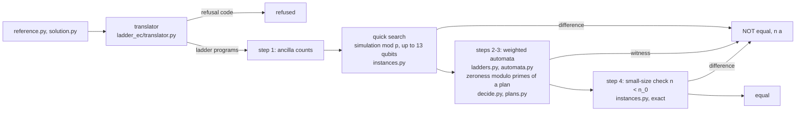

# ladder_ec

Parameterized equivalence checking of quantum circuit generators via weighted automata: `ladder_ec` decides whether two
Qiskit generators `solve(n)` or `solve(n, a)` build equivalent circuits for every size `n` and every bit string `a`.

This repository holds the code, the benchmark and the run data of the paper "Parameterized equivalence checking of
quantum circuit generators via weighted automata" (P. Chuklanov).

## Quick start

```
pip install -e .            # Python 3.13, Qiskit 2.5.2, NumPy 2.5.3
```

`tests/generators/ghz.py` has three GHZ generators: `ghz_ref` (CNOT chain), `ghz_star` (all CNOTs from qubit 0) and
`ghz_phase` (the chain followed by Z on the last qubit).

```
$ python -m ladder_ec tests/generators/ghz.py:ghz_ref tests/generators/ghz.py:ghz_star --relation eq0
equal, exact

$ python -m ladder_ec tests/generators/ghz.py:ghz_ref tests/generators/ghz.py:ghz_star --relation eq
NOT equal
counterexample at n = 3 (found by quick_search)

$ python -m ladder_ec tests/generators/ghz.py:ghz_ref tests/generators/ghz.py:ghz_phase --relation eq0_phase
NOT equal
counterexample at n = 1 (found by quick_search)
```

The same from Python:

```python
from ladder_ec import check
r = check("tests/generators/ghz.py:ghz_ref", "tests/generators/ghz.py:ghz_star", relation="eq0")
r["answer"]          # 'equal, exact'
r["counterexample"]  # None, or {"n": ..., "found_by": ...}
r["details"]         # full output: statuses, primes, n_cut, seed, timings
```

`--seed S` fixes the seed of the probabilistic plan (it is always written to the output); `--json` prints everything.

## Relations (Definition 2)

| `--relation` | Key in data | Compared | Exact / up to global phase |
|---|---|---|---|
| `eq` | `E1` | matrix U | exact |
| `eq_phase` (default) | `E2` | matrix U | up to global phase |
| `eq0` | `E5strict` | state U\|0^N> | exact |
| `eq0_phase` | `E5phase` | state U\|0^N> | up to global phase |
| `eq_anc` | `E3` | operator V on working qubits, ancillas returned to \|0> | exact |
| `eq_anc_phase` | `E3phase` | operator V on working qubits, ancillas returned to \|0> | up to global phase |

## Answers (Table 2)

| Answer | When | What is claimed |
|---|---|---|
| `NOT equal` with a counterexample `(n, a)` | a difference found by the quick search, the automata or step 4 | the generators differ at that instance (exact) |
| `equal, exact` | the exact plan, or the automata are zero for all primes needed | equal for all n and a |
| `equal, error <= 2^-k` | probabilistic plan with computed error estimate below 2^-40 | equal, with that error probability |
| `reference does not return its ancillas` | ancilla relations only | the relation is undefined for this reference |
| `no answer (error bound >= 1)`, `no answer (no primes)` | the plan cannot certify | nothing |
| `refused (translator)` | a generator is outside the supported fragment or the class | nothing; the refusal code is in `details` |

## Pipeline (Algorithm 1)



## Repository map

| Path | Contents |
|---|---|
| `ladder_ec/` | the method: `translator.py` (Python to ladder programs, Sec. 6.1), `ladders.py` (automaton of a ladder, Thm. 1), `automata.py` (weighted automata modulo p, minimization), `field.py` (gate entries modulo p), `plans.py` (prime plans, Thm. S.12, S.13), `decide.py` (zeroness per relation), `instances.py` (quick search, step 4), `check.py` (Algorithm 1, `check`), `__main__.py` (CLI) |
| `tests/` | pytest suite (`python -m pytest`) |
| `data/benchmark/` | the 2332 reference–solution pairs: generators `gen_*.py`, `pairs.jsonl`, `pairs_second.jsonl`, `truth.jsonl` |
| `data/runs/` | outputs of the runs used in the paper; machines in `data/runs/MACHINE.md` |
| `data/own_generators/` | our 62 generators for other tasks (Table 10, row "own generators") |
| `data/external/` | our classification of the MQT Bench refusals |
| `experiments/` | scripts that produce `data/runs/` and the tables and figures |
| `experiments/tables/`, `experiments/figures/` | Tables 3-10, Fig. 6, S1, S2 from `data/` (they run nothing) |
| `experiments/checks/` | checks of Sec. 5-7: translator against Qiskit, Theorem 1 bound, examples of Sec. 5 |
| `third_party/quantumkatas/` | QuantumKatas material, CC BY-NC-SA 4.0 |
| `THIRD_PARTY.md` | external sources, versions, licences |

## Reproducing the paper

The table and figure scripts read only `data/` and run in seconds. Runtimes of the runs are on the machines of
`data/runs/MACHINE.md` (one core). `pip install -e .[experiments]` adds mqt.qcec and matplotlib.

| Item | Run (writes data/runs/) | Table or figure script | Runtime of the run |
|---|---|---|---|
| benchmark | `experiments/benchmark/make_benchmark.py`, `ground_truth.py`, `make_second_relations.py` | - | minutes |
| Table 3 | - | `experiments/tables/table03_mutations.py` | - |
| Table 4 | `experiments/run_method.py main`, then `main --retry`; `second`, `second --retry` | `experiments/tables/table04_answers.py` | 10 min + 12 min |
| Table 5 | `experiments/instance_checks.py`; `experiments/run_method.py no_quick_search` | `experiments/tables/table05_detection.py` | 30 min; 40 min |
| Table 6 | `experiments/qcec/enumerate_sizes.py ncut`, `ncut_min` | `experiments/tables/table06_qcec_equal.py` | 3.2 h; 20 min |
| Table 7 | `experiments/qcec/enumerate_sizes.py witness` | `experiments/tables/table07_qcec_unequal.py` | 1.1 h |
| Table 8 | `experiments/step4/run_step4.py ours`, `qcec` | `experiments/tables/table08_step4.py` | 35 min; 2 min |
| Table 9 | `experiments/autoq_para/fetch_and_build.sh`, `run_autoq.sh`, `run_ours.py` | `experiments/tables/table09_autoq_para.py` | minutes |
| Table 10 | `experiments/external/quantumkatas/{select_katas,run_katas,llm_katas,llm_katas_rerun}.py`, `experiments/external/quanbench/{fetch.sh,translate.py}`, `experiments/external/mqtbench/{fetch.sh,strip_defaults.py,check_rewrites.py}`, `experiments/external/own_generators/refusals.py` | `experiments/tables/table10_applicability.py` | 3 min |
| Fig. 6 | runs of Tables 4 and 6 | `experiments/figures/fig6_times.py` | - |
| Fig. S1 | `experiments/exact_plan.py` (exact plan without the cap on T, 30 min per pair) | `experiments/figures/figS1_plans.py` | 10 h |
| Fig. S2 | `experiments/checks/ladder_dims.py` | `experiments/figures/figS2_bound.py` | 15 s |

Commands are run from the repository root as `python -I <script>`. The method runs accept `--seeds FILE` to repeat
the probabilistic plans of a shipped output; with the shipped seeds a rerun gives the same answers, counterexamples,
primes and n_cut on all pairs (times differ).

## Supported fragment

The translator reads the source of `solve(n)` or `solve(n, a)` and never runs it. It accepts straight-line Qiskit
code with the gates `h x y z s sdg t tdg p rx ry rz cx cy cz ch cp crz swap rzz ccx ccz cswap` on qubit
indices affine in `n` and in loop counters, `for` loops over `range` (and `reversed(range)` with step 1, slices of
qubit lists), conditions `if a[k]`, `(a >> k) & 1` or `a & (1 << k)` on bits of `a`, constant angles that are rational multiples of
pi, and calls of helper functions of the same module. The full rules and assumptions are in Online Resource 1, Sect.
S2. A function outside the fragment, or a program outside the class of ladder programs (Definition 3), is refused
with a code:

| Code | Kind | Example |
|---|---|---|
| `branch_on_size` | class | `if n > N0`, `if n % 3 == 0` |
| `branch_on_loop_index` | class | `if i == N0`, `if i % 3 == 0` |
| `branch_on_param` | class | `if len(a) > 3` |
| `conditional_expression` | both | `range(n - 1 if n % 2 else n - 2)` |
| `nonaffine_expression`, `nonaffine_index` | both | `(i + 1) % n`, `range(n // 2)`, `2 ** j` |
| `nested_loop` | class | the double loop of QFT |
| `while_loop`, `recursion` | both | doubling trees, recursive QFT |
| `growing_arity` | class | `mcx`, `mcp` on a list whose length grows with n or i |
| `library_gate` | fragment | `compose`, `append`, `.inverse()` |
| `nonconst_angle` | class | `2 * acos(sqrt(1 / (n - i)))`, `pi / 2 ** i` |
| `two_registers`, `fold_index`, `stride_index` | class | indices `n + i`, `n - 1 - i`, `2 * i + 1` |
| `index_out_of_range`, `qubit_collision` | class | `cx(i, i + 1)` over `range(n)` on n qubits; `cx(0, i)` at i = 0 |
| `bit_index_negative`, `bit_index_out_of_range` | class | `a[i - 1]` at i = 0; `(a >> (i + 1)) & 1` at i = n - 1 |
| `bit_on_end_fixed` | class | a condition on the bit `a[n + c]` in a ladder body |
| `bit_const_in_down_ladder` | class | `for i in range(n - 1, 0, -1): if a[0]: qc.x(i)` |
| `fixed_overlaps_window`, `fixed_inside_ladder` | class | the window position `i - 1` meets the fixed qubit 0 at i = 1; `for i in range(n): if a[0]: qc.x(i)` |
| `alias_reassigned`, `alias_under_condition`, `loop_var_after_loop` | fragment | `t = t + 1`; assignment under `if a[i]`; loop counter used after the loop |
| `bit_param_misuse` | both | `range(a)`, `a[i]` outside a condition |
| `range_not_ladder` | both | `reversed(range(0, n, 2))`, a loop over an explicit list |
| `body_without_window` | class | `for _ in range(n): qc.x(0)` |
| `no_size_dependence`, `no_ladder` | both, fragment | a circuit of fixed size |
| `unknown_call`, `unknown_name`, `unknown_gate`, `unsupported_statement`, `unsupported_expression`, `extra_params`, `shadowed_builtin` | fragment | `getattr`, `try`, a default parameter, `QuantumRegister`, a redefined `range` |
| `early_return`, `nonint_constant`, `broadcast_multi`, `not_const`, `no_size_param` | fragment | `return` before the end; a float where an index is expected; no size parameter |

Kind: "class" means the code is in the fragment but the program is not a ladder program; "fragment" means the code
is outside the supported Python; "both" means it depends on the case.

## Citing

See `CITATION.cff`. Until the paper is published, cite the software:
P. Chuklanov, ladder_ec 1.0.0, 2026, doi:10.5281/zenodo.XXXXXXX.

## License

MIT, see `LICENSE`. `third_party/quantumkatas/` is CC BY-NC-SA 4.0; external sources are listed in
`THIRD_PARTY.md`.
